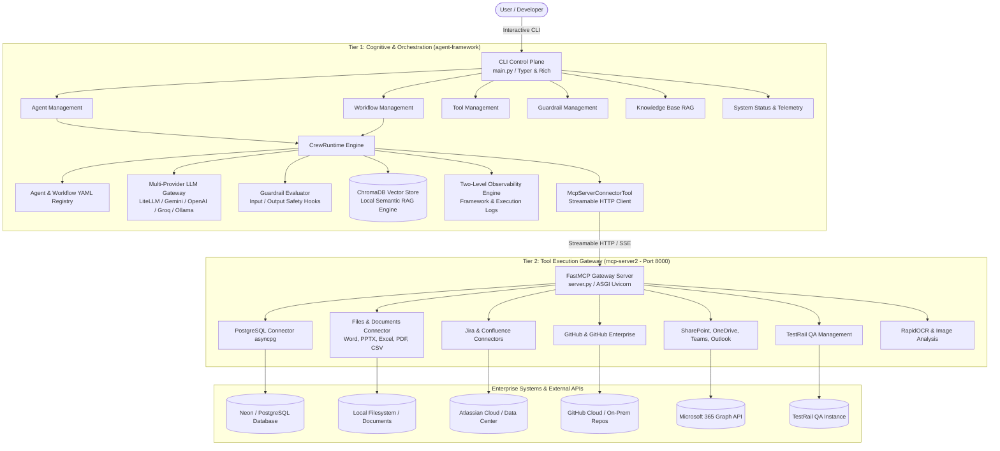
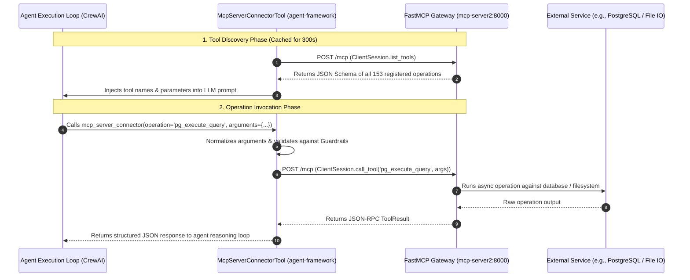
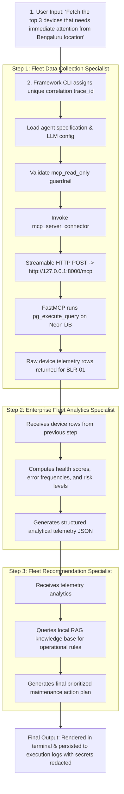

# Enterprise Agent Framework (v7)
## System Design & Technical Architecture Document

---

## 1. Executive Summary & Architecture Principles

The **Enterprise Agent Framework (v7)** is an enterprise-grade platform designed for building, orchestrating, governing, and executing autonomous AI agents, multi-agent workflows, and enterprise tool integrations. 

### Core Architectural Principles

1. **Decoupled Dual-Tier Architecture**: Separation of the **Cognitive & Orchestration Tier** (`agent-framework`) from the **Tool Execution Tier** (`mcp-server2`). The agent runtime never bundles heavy enterprise drivers or client SDKs.
2. **Open Standard Connectivity (MCP)**: All tool integrations use the open **Model Context Protocol (FastMCP)** over Streamable HTTP / Server-Sent Events (SSE).
3. **Declarative Agent & Workflow Schemas**: Personas, capabilities, tool bindings, and prompt contracts are defined declaratively in version-controlled YAML files.
4. **Deterministic Guardrails**: Multi-phase safety hooks (`input`, `output`, `both`) that deterministically enforce organizational policies and prevent unauthorized operations with `block` or `warn` actions.
5. **Grounded Reasoning via RAG**: Local, persistent vector search (ChromaDB) enables agents to cite verified facts and document excerpts.
6. **Zero-Leakage Observability**: Two-level audit logging (Framework vs. Execution logs) with automated regex masking for credentials, tokens, and secrets.

---

## 2. High-Level System Architecture

The following diagram illustrates the complete end-to-end system topology:



---

## 3. Communication Protocol: Model Context Protocol (MCP)

Communication between `agent-framework` and `mcp-server2` is established strictly over the **Model Context Protocol (FastMCP)**.



### Technical Details of `McpServerConnectorTool`:
- **Protocol**: JSON-RPC over Streamable HTTP (`mcp.client.streamable_http`).
- **Endpoint**: Configured via `MCP_SERVER_URL` in `.env` (default: `http://127.0.0.1:8000/mcp`).
- **Catalog Caching**: Discovered tool schemas are cached in memory for 300 seconds (`_cached_summary`) to prevent network flooding.
- **Payload Normalization**: Automatically converts plain text instructions, JSON strings, or dictionaries into normalized tool parameters.

---

## 4. Tier 1 Deep-Dive: The Agent Framework (`agent-framework`)

### 4.1 Folder Structure
```text
agent-framework/
├── agents/
│   ├── definitions/          # Declarative YAML specifications for each agent
│   └── agent_commands.py     # CLI menu for Create, Edit, Delete, List, Execute, Search
├── workflows/
│   ├── definitions/          # YAML definitions for multi-agent workflows
│   └── workflow_commands.py  # CLI menu for Workflow lifecycle & execution
├── tools/
│   ├── definitions/          # Tool metadata and parameters
│   └── implementations/      # Python tool implementations (e.g. mcp_server_connector)
├── guardrails/
│   ├── definitions/          # Guardrail rules, policies, and phase triggers
│   └── implementations/      # Deterministic validation scripts (Python)
├── src/
│   ├── cli/                  # Terminal UI built on Typer and Rich
│   ├── llm/                  # Multi-provider LLM gateway for specification generation
│   ├── observability/        # Two-level partitioned logging & secret masking
│   ├── rag/                  # ChromaDB vector store, document chunking & retrieval
│   └── runtime/              # CrewAI execution adapter, task routing, and LLM resolver
└── main.py                   # Main CLI entry point
```

### 4.2 Declarative Agent Specifications
Every agent is defined in YAML (`agents/definitions/<id>.yaml`):
- **Identity & Persona**: `role`, `goal`, `back_story`, and `description` defining the agent's core capability and responsibilities.
- **LLM Configuration**: Provider (`gemini`, `openai`, `anthropic`, `groq`, `ollama`), model identifier, temperature, top-p, and execution limits (`max_iteration`, `max_rpm`, `max_execution_time`).
- **Tool Bindings**: Attached local tools (`knowledge_search`) or remote bridges (`mcp_server_connector`).
- **Guardrail Bindings**: Assigned deterministic safety hooks.
- **Input/Output Schemas**: Structured contracts with sample payloads presented to the user during CLI invocation.

### 4.3 Runtime Orchestration Engine
- **`CrewRuntime`**: Translates declarative YAML specifications into CrewAI `Agent` and `Task` objects.
- **`CrewToolAdapter`**: Standardizes both local Python tools and `McpServerConnectorTool` into CrewAI-compatible tool instances.
- **`llm_resolver.py`**: Resolves the execution LLM based on environment configuration (`EXECUTION_LLM_PROVIDER` falling back to `LLM_PROVIDER`), constructing appropriate LiteLLM prefixes (`gemini/`, `openai/`, `anthropic/`, `groq/`, `ollama/`).

### 4.4 Workflow Execution Topologies
Workflows (`workflows/definitions/<id>.yaml`) chain multiple agents together:
- **Sequential Execution**: Output from Step $N$ is formatted and passed as input context to Step $N+1$.
- **Hierarchical Execution**: A coordinator agent dynamically routes sub-tasks to specialized agents based on intermediate results.
- **Trace Context**: A shared correlation `trace_id` is propagated across every nested agent, tool, guardrail, and RAG retrieval call.

### 4.5 Deterministic Guardrails Subsystem
Guardrails enforce boundaries before or after an agent executes:
- **Phases**: `input` (pre-execution), `output` (post-execution), or `both`.
- **Actions**:
  - `block`: Immediately aborts execution with a `GuardrailViolationError`.
  - `warn`: Logs an audit finding and permits execution to continue.
- **Example (`mcp_read_only.py`)**: Intercepts SQL queries intended for `pg_execute_query` to verify that they begin strictly with read-only verbs (`SELECT`, `WITH`, `SHOW`, `EXPLAIN`). Destructive queries (`DROP`, `DELETE`, `TRUNCATE`) are blocked before hitting the database.

### 4.6 Retrieval-Augmented Generation (RAG) Subsystem
- **Engine**: Persistent ChromaDB instance stored at `data/chromadb/`.
- **Format Parsers**: Ingests `.pdf`, `.docx`, `.md`, `.txt`, `.csv`, `.json`, `.yaml`, `.log`.
- **Chunking Pipeline**: Text is extracted, tokenized, and partitioned into overlapping chunks with source metadata.
- **Semantic Retrieval**: The `knowledge_search` tool allows agents to query the vector database and retrieve relevant excerpts along with source filenames.

### 4.7 Observability & Logging Architecture
- **Two-Level Partitioned Logs**:
  - **Framework Logs** (`logs/framework/YYYY-MM-DD/framework.log`): System events, menu choices, configuration loads.
  - **Execution Logs** (`logs/executions/<category>/YYYY-MM-DD/<entity>.log`): Dedicated log per concrete entity (`DocumentUpdateSpecialist.log`, `hp_smart_print_fleet_optimization.log`, etc.).
- **Automated Secret Masking**: Regex patterns replace API keys (`AIza...`, `sk-...`, `Bearer ...`) and key-value secrets (`password`, `token`, `secret`) with `[REDACTED]`.
- **File Rotation**: Capped at 10 MB with 20 historical backups.

---

## 5. Tier 2 Deep-Dive: The MCP Gateway (`mcp-server2`)

The MCP Gateway is an independent microservice that unifies 12 enterprise connectors under a single FastMCP server.

### 5.1 Gateway Architecture (`server.py`)
- **Server Instance**: FastMCP instance named `all-connectors-gateway`.
- **Dynamic Connector Merging**: At startup, `server.py` iterates over `CONNECTOR_MODULES`, dynamically importing each module and copying registered `@mcp.tool()` handlers into the central registry.
- **Graceful Fault-Tolerance**: If a connector fails to load (e.g. missing credentials or optional dependencies), it is skipped without interrupting other connectors.
- **Transport Modes**:
  - `python server.py`: Standalone smoke test.
  - `python server.py --serve`: Stdio mode.
  - `python server.py --serve --transport http --port 8000`: Production HTTP mode over ASGI/Uvicorn.

### 5.2 The 12 Enterprise Connectors

| Connector | Module | Key Operations | Underlying Tech |
|---|---|---|---|
| **PostgreSQL** | `postgresql.py` | `pg_list_tables`, `pg_describe_table`, `pg_select_rows`, `pg_execute_query`, `pg_insert_row` | `asyncpg` async connection pooling |
| **Files & Documents** | `files.py` | `pptx_modify`, `pptx_create`, `docx_create`, `docx_replace_text`, `xlsx_update_cell`, `pdf_create`, `csv_read` | `python-pptx`, `python-docx`, `openpyxl`, `pypdf` |
| **Jira** | `jira.py` | `jira_get_issue`, `jira_search_issues`, `jira_create_issue`, `jira_add_comment`, `jira_list_projects` | `httpx.AsyncClient` REST |
| **Confluence** | `confluence.py` | `confluence_list_spaces`, `confluence_get_page`, `confluence_create_page`, `confluence_search_pages` | `httpx.AsyncClient` REST |
| **GitHub** | `github.py` | `github_list_repos`, `github_get_file`, `github_create_issue`, `github_create_or_update_file` | GitHub REST v3 API |
| **GitHub Enterprise** | `github_enterprise.py` | `ghe_list_repos`, `ghe_get_file`, `ghe_create_issue`, `ghe_create_or_update_file` | Self-hosted GHE API |
| **SharePoint** | `sharepoint.py` | `sharepoint_list_lists`, `sharepoint_list_items`, `sharepoint_read_file`, `sharepoint_upload_file` | Microsoft Graph API |
| **OneDrive** | `onedrive.py` | `onedrive_list_items`, `onedrive_read_file`, `onedrive_upload_file`, `onedrive_search` | Microsoft Graph API |
| **Teams** | `teams.py` | `teams_list_channels`, `teams_send_channel_message`, `teams_list_chats`, `teams_send_chat_message` | Microsoft Graph API |
| **Outlook** | `outlook.py` | `outlook_list_messages`, `outlook_send_message`, `outlook_list_events`, `outlook_create_event` | Microsoft Graph API |
| **TestRail** | `testrail.py` | `testrail_list_projects`, `testrail_list_cases`, `testrail_create_run`, `testrail_close_run` | TestRail v2 API |
| **Image Analysis** | `image.py` | `image_analyze` (OCR text extraction + visual intent label) | `RapidOCR` + `onnxruntime` |

### 5.3 Flexible Secret Configuration (`env_config.py`)
Supports plain text values as well as Base64-prefixed values (`base64:...`) to prevent shell quoting errors and format corruptions.

---

## 6. End-to-End Workflow Execution Walkthrough

Here is how data flows during a complete workflow execution (**HP Smart Print Fleet Optimization**):



---

## 7. Configuration Reference

### `agent-framework/.env`
| Key | Purpose | Example |
|---|---|---|
| `LLM_PROVIDER` | LLM for spec generation | `gemini`, `openai`, `groq`, `ollama` |
| `EXECUTION_LLM_PROVIDER` | LLM for runtime task execution | `gemini` |
| `GEMINI_API_KEY` | Google Gemini API Key | `AIzaSy...` |
| `GEMINI_MODEL` | Google Gemini Model | `gemini-2.0-flash` |
| `MCP_SERVER_URL` | FastMCP Gateway Endpoint | `http://127.0.0.1:8000/mcp` |
| `CHROMADB_PATH` | Path to vector store | `./data/chromadb` |
| `EAF_LOG_DIR` | Base directory for audit logs | `logs` |

### `mcp-server2/.env`
| Key | Purpose |
|---|---|
| `PG_HOST`, `PG_PORT`, `PG_DATABASE`, `PG_USER`, `PG_PASSWORD` | PostgreSQL credentials |
| `FILES_ROOT_DIR` | Base directory for local file operations |
| `JIRA_*`, `CONFLUENCE_*` | Atlassian credentials |
| `GITHUB_*`, `GITHUB_ENTERPRISE_*` | GitHub credentials |
| `AZURE_TENANT_ID`, `AZURE_CLIENT_ID`, `AZURE_CLIENT_SECRET` | Azure AD app registration for M365 connectors |
| `TESTRAIL_*` | TestRail QA credentials |

---

## 8. Summary of File Architecture

| Component | Path |
|---|---|
| **System Architecture Guide** | `SYSTEM_ARCHITECTURE_AND_DESIGN.md` |
| **Interactive CLI** | `agent-framework/main.py` |
| **Agent Definitions** | `agent-framework/agents/definitions/*.yaml` |
| **Workflow Definitions** | `agent-framework/workflows/definitions/*.yaml` |
| **MCP Client Bridge** | `agent-framework/tools/implementations/mcp_server_connector.py` |
| **FastMCP Gateway Server** | `mcp-server2/server.py` |
| **Database Connector** | `mcp-server2/postgresql.py` |
| **Files & Documents Connector** | `mcp-server2/files.py` |

